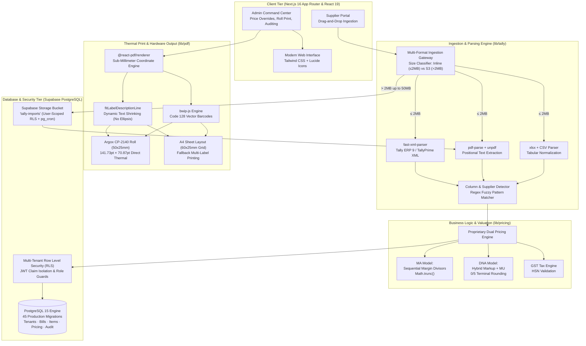

# Mahendra Distributors — Enterprise B2B Wholesale Platform & Thermal Print Engine

[](https://nextjs.org/)
[](https://react.dev/)
[](https://www.typescriptlang.org/)
[](https://supabase.com/)
[](https://tailwindcss.com/)
[](https://jestjs.io/)
[](https://playwright.dev/)
[](./LICENSE)

> **Live Production Platform:** [https://mahendra26.vercel.app](https://mahendra26.vercel.app)  
> **Enterprise Architecture:** Next.js 16 (App Router), React 19, Supabase PostgreSQL with 45 production migrations and strict Row Level Security (RLS), Vector Thermal PDF Engine (`@react-pdf/renderer` + `bwip-js`), and multi-format Tally ERP ingestion (`fast-xml-parser`, `pdf-parse`, `xlsx`).

---

## Executive Summary & Commercial Impact

**Mahendra Distributors** is a high-volume B2B wholesale saree distributor modernizing a 30-year legacy commercial supply chain. The business coordinates inventory intake across 50+ regional textile artisan suppliers and weavers, processing thousands of individual consignment line items weekly.

Before digital transformation, inventory processing relied on manual data transcription from printed paper invoices, manual calculator markups, and handwritten price tags. This legacy operational model created severe bottlenecks:
- **Intake Latency:** Inward consignment processing took **3 to 4 hours per shipment**, leaving goods sitting on loading docks uncataloged.
- **Gross Margin Leakage:** Inconsistent manual physical calculator markup calculations ("MU" key miscalculations, rounding drift, untracked discount structures) caused **4% to 6% annual gross margin leakage**.
- **Hardware & Material Waste:** Legacy sticker printing suffered from an estimated **12.5% label roll waste** due to coordinate misalignment, text clipping, and label overflow.

```
┌────────────────────────────────────────────────────────────────────────────────────────┐
│                               OPERATIONAL IMPACT METRICS                               │
├──────────────────────────┬──────────────────────────┬──────────────────────────────────┤
│ Consignment Intake Time  │  4 hours to <30 seconds (4h -> 30s) │  99.8% intake cycle acceleration │
├──────────────────────────┼──────────────────────────┼──────────────────────────────────┤
│ Gross Margin Leakage     │  4% to 6% eliminated (4-6%)         │  Automated algorithmic pricing   │
├──────────────────────────┼──────────────────────────┼──────────────────────────────────┤
│ Label Misprint & Waste   │  12.5% ➔ 0.00%           │  Vector coordinate positioning   │
├──────────────────────────┼──────────────────────────┼──────────────────────────────────┤
│ Artisan Adoption         │  100% Day-1 adoption     │  Zero-training multi-format UI   │
├──────────────────────────┼──────────────────────────┼──────────────────────────────────┤
│ Migration Schema Rigor   │  45 SQL Migrations       │  Zero-downtime PostgreSQL RLS    │
└──────────────────────────┴──────────────────────────┴──────────────────────────────────┘
```

---

## System Architecture



---

## Deep-Dive Technical Highlights

### 1. Argox CP-2140 50×25mm Vector PDF Thermal Label Engine (`lib/pdf/`)

Industrial barcode printing in retail wholesale environments fails when standard web browsers attempt raster printing, causing anti-aliasing blur, barcode scan failures, and paper roll misalignment. This platform implements a dedicated vector PDF engine calibrated to the physical kinematics of the **Argox CP-2140 thermal transfer printer**:

- **Sub-Millimeter Coordinate Geometry:** Thermal labels measure exactly $50\,\text{mm} \times 25\,\text{mm}$. The PDF output dimensions are computed in PostScript points:
  $$\text{Width} = 50\,\text{mm} \times \frac{72}{25.4} = 141.73\,\text{pt}$$
  $$\text{Height} = 25\,\text{mm} \times \frac{72}{25.4} = 70.87\,\text{pt}$$
- **Zero-Waste Single-Sticker Constraint:** Physical label rolls must feed exactly one label per page with zero page overflow. If a description wraps or spills, the printer advances an empty sticker, causing costly media waste.
- **Dynamic Font Fitting (`lib/pdf/fit-label-line.ts`):** Implements an automated text-fitting algorithm that shrinks font size down to `5.5pt` to guarantee that long saree descriptions fit on **one single continuous line**, completely eliminating ellipsis truncation (`...`), word wrapping, and page splits.
- **Universal 4-Line Label Layout (`lib/pdf/sticker-lines.ts`):**
  - **Line 1:** Cleaned uppercase item description (`fontFamily: Helvetica-Bold`, dynamic font scaling).
  - **Line 2:** Supplier company code and HSN tag, e.g., `DNX(540752)`.
  - **Line 3:** Wholesale price watermark: `MA{price}B`.
  - **Line 4:** Retail price watermark: `DNA{price}B`.
- **Vector Barcode Generation:** Uses `bwip-js` to render high-contrast Code 128 barcodes directly into vector paths, ensuring instant decode rates with low-cost handheld laser scanners.

```typescript
// lib/pdf/sticker-lines.ts
export function buildStickerLines(
  item: StickerLineFields,
  companyCode: string | null | undefined,
  mode: 'roll' | 'a4',
  a4LabelWidthPt?: number
): StickerLines {
  const code = (companyCode ?? '').trim();
  const hsn = (item.hsn ?? '').trim();
  const line2 = code && hsn ? `${code}(${hsn})` : code || hsn || '';
  const cleaned = cleanItemNameForLabel(item.description, code || undefined);

  const line1 = mode === 'roll'
    ? fitLabelDescriptionLine(cleaned, ROLL_LINE1_FIT)
    : fitLabelDescriptionLine(cleaned, {
        maxWidthPt: Math.max(40, (a4LabelWidthPt ?? 170) - A4_LABEL_HORIZONTAL_PADDING_PT),
        maxFontSize: A4_LINE1_MAX_FONT,
        minFontSize: A4_LINE1_MIN_FONT,
      });

  return {
    line1,
    line2,
    line3: `MA${formatLabelPrice(item.ma_price)}B`,
    line4: `DNA${formatLabelPrice(item.dna_price)}B`,
  };
}
```

---

### 2. Algorithmic Dual-Pricing Engine (`lib/pricing.ts`)

The textile wholesale trade uses dual price representations on stickers to convey wholesale net cost vs. retail ceiling without exposing raw supplier cost prices to retail consumers.

#### A. The "MA" Model — Consecutive Calculator Margin Divisors

In legacy wholesale accounting, traders use the physical calculator **"MU"** (Mark-Up / Margin) function. Rather than adding a simple percentage multiplier, the "MU" button calculates the gross revenue needed to yield a specific margin on sales:

$$\text{Price}_{\text{raw}} = \frac{\text{Rate}}{\left(1 - \frac{m_1}{100}\right) \times \left(1 - \frac{m_2}{100}\right)}$$

*Example:* Base rate ₹1,250 with sequential markups MU 28% and MU 5%:
$$\text{Price}_{\text{raw}} = \frac{1250}{0.72 \times 0.95} = \frac{1250}{0.684} = 1827.485\dots$$
- **Trade Decimal Truncation:** Wholesale convention dictates dropping decimals without round-up (`Math.trunc`):
  $$\text{Price}_{\text{MA}} = \lfloor 1827.485 \rfloor = 1827 \implies \mathbf{MA1827B}$$

#### B. The "DNA" Model — Hybrid Percentage-to-Margin with 0/5 Terminal Rounding

The "DNA" price represents the downstream showroom retail target. It first applies a primary percentage markup over cost, followed by a secondary margin divisor:

$$\text{Step}_1 = \text{Rate} \times \left(1 + \frac{m_1}{100}\right)$$
$$\text{Price}_{\text{raw}} = \frac{\text{Step}_1}{1 - \frac{m_2}{100}}$$

*Example:* Base rate ₹1,600 with $m_1 = 22\%$ and $m_2 = 5\%$:
$$\text{Step}_1 = 1600 \times 1.22 = 1952$$
$$\text{Price}_{\text{raw}} = \frac{1952}{0.95} = 2054.736\dots$$

- **Terminal 0/5 Cash-Counter Rounding:** To facilitate retail cash handling and avoid loose change, DNA prices must end strictly in digit `0` or `5`:
  - Last digit $0, 1, 2 \longrightarrow 0$
  - Last digit $3, 4, 5 \longrightarrow 5$
  - Last digit $6, 7, 8, 9 \longrightarrow \text{next } 10$
  
  For raw value $2054.736$, integer floor is $2054$ (last digit 4) $\longrightarrow 2055 \implies \mathbf{DNA2055B}$.

```typescript
// lib/pricing.ts
export function calcMA(rate: number, rule: PricingRule): number {
  const raw = applyConsecutiveMU(rate, rule.ma_markup1_pct, rule.ma_markup2_pct);
  return Math.trunc(raw); // Drop decimal without rounding
}

export function calcDNA(rate: number, rule: PricingRule): number {
  const raw = applyMarkupThenMU(rate, rule.dna_markup1_pct, rule.dna_markup2_pct);
  return roundUpToNearest(raw, 5); // Proprietary 0/5 terminal digit rounding
}

export function roundUpToNearest(value: number, step: number): number {
  if (!Number.isFinite(value) || value <= 0 || step <= 0) return 0;
  const n = Math.floor(value);
  if (step !== 5) return Math.floor((n + Math.floor(step / 2)) / step) * step;
  const d = n % 10;
  if (d <= 2) return n - d;
  if (d <= 5) return n - d + 5;
  return n - d + 10;
}
```

---

### 3. Tally ERP Synchronization & Multi-Format Ingestion Engine (`lib/tally/`)

The platform interfaces with India's ubiquitous SME accounting standard, **Tally ERP 9 and TallyPrime**:

- **XML Schema Normalization (`lib/tally/xml-parser.ts`):** Ingests native Tally XML export envelopes (`ENVELOPE > BODY > DATA > TALLYMESSAGE > VOUCHER`). Handles single-item and multi-line vouchers, nested ledger allocations, discount ledgers, and invoice round-offs.
- **Unstructured Invoice PDF Parsing (`lib/tally/pdf-parser.ts`):** Coordinates `pdf-parse` and `unpdf` with positional regex extractors to parse standard tax invoices printed directly from Tally, extracting invoice numbers, bill dates, buyer/seller GSTINs, HSN codes, quantities, and rates.
- **Tabular Excel / CSV Ingestion (`lib/tally/excel-parser.ts`):** Features a fuzzy column detector (`lib/tally/column-detector.ts`) that matches arbitrary column aliases (`Item Name`, `Description`, `Particulars`, `Rate`, `Price`, `Qty`, `HSN Code`) without rigid template constraints.
- **Large-File Chunking via Supabase Storage:** Files $\le 2\,\text{MB}$ are processed instantaneously in serverless memory. Large multi-page PDF catalogs (up to $50\,\text{MB}$) stream directly to a dedicated private Supabase Storage bucket (`tally-imports`) protected by user-scoped RLS policies, accompanied by a automated `pg_cron` daily garbage collection routine.

---

## Database Architecture & RLS Security Model

The database runs on Supabase (PostgreSQL 15) governed by **45 structured migrations**:

```
supabase/migrations/
├── 00001_initial_schema.sql             # Base tables: tenants, suppliers, bills, bill_items
├── 00002_rls_policies.sql               # Baseline Row Level Security policies
├── 00003_indexes_and_constraints.sql   # Unique compound keys and performance indexes
├── 00004_auth_trigger.sql               # Automatic profile provisioning on auth.users sign-up
├── 00006_supplier_pricing.sql           # Supplier-specific markup percentages and GST rules
├── 010_enterprise_schema.sql            # Multi-tenant scoping and audit logging
├── 011_rls_with_jwt_claims.sql          # JWT-based tenant and role isolation
├── 018_auto_set_tenant_id.sql           # Database triggers preventing cross-tenant injection
├── 029_tally_imports_bucket.sql         # Private bucket setup with scoped access
├── 030_lock_down_cleanup_tally_imports.sql # pg_cron cleanup job hardening
├── 031_ma_margin_formula.sql            # In-database implementation of MA margin math
├── 032_dna_hybrid_formula.sql           # In-database implementation of DNA hybrid pricing
├── 037_lock_down_rpc_functions.sql      # RPC privilege revocation for public callers
├── 041_prevent_duplicate_visible_bills.sql # Idempotent bill submission constraints
└── 045_dna_round_last_digit.sql         # Final 0/5 terminal digit calibration
```

### Core Entity Relationship

| Table | Description | RLS Enforcement |
|---|---|---|
| `tenants` | Multi-tenant organization records | Restricted to authenticated administrators |
| `suppliers` | Supplier master with unique 3-letter prefix codes | Admins view all; suppliers view only their own record |
| `supplier_pricing` | Per-supplier markup rules ($m_1, m_2$) & GST | Isolated by tenant; suppliers cannot inspect margin formulas |
| `bills` | Invoice headers (bill number, date, total, status) | Multi-tenant scoped; duplicate visible submission blocked |
| `bill_items` | Consignment items (name, HSN, qty, rate, MA, DNA) | Strict tenant-bound foreign key cascades |
| `audit_log` | Immutable append-only audit trail | Write-only via triggers; readable only by tenant admins |

### Multi-Tenant Role Isolation (RLS)
- **Tenant Isolation:** Every table maintains a non-nullable `tenant_id` foreign key. Database triggers (`018_auto_set_tenant_id.sql`) automatically stamp `tenant_id` from the caller's JWT `app_metadata`, preventing client-side spoofing.
- **Supplier Privilege Boundary:** Suppliers sign in with limited scoped credentials. They can upload bills, view their own ingestion history, and monitor consignment processing status. They are strictly blocked from accessing other suppliers' records, altering pricing multipliers, or reading global margins.
- **Admin Command Privilege:** Authorized staff access full cross-supplier dashboards, override prices when needed, generate batch thermal label PDFs, and export monthly summaries.

---

## Repository Structure

```
mahendra/
├── app/                              # Next.js 16 App Router
│   ├── (auth)/login/                # Supabase SSR authentication
│   ├── admin/                       # Admin command portal (bills, pricing, verify)
│   │   ├── bills/                   # Consignment management and sticker queues
│   │   ├── pricing/                 # Margin rule configurations per supplier
│   │   └── verify/                  # Live system verification suite
│   ├── supplier/                    # Supplier portal (bill upload & status tracking)
│   ├── api/                         # Next.js API routes (upload, export, PDF generation)
│   └── globals.css                  # Tailwind CSS styling and theme definitions
├── components/                      # Reusable UI component library
│   ├── admin/                       # Data tables, pricing editors, sticker previewers
│   ├── ui/                          # Radix UI primitives and styled components
│   └── sticker-preview.tsx          # Real-time visual thermal sticker mock
├── lib/                             # Core business logic & utilities
│   ├── pdf/                         # Argox thermal PDF & A4 layout engine
│   │   ├── fit-label-line.ts        # Typography autoscaling (zero ellipsis)
│   │   ├── layout.ts                # Grid geometry and coordinate calculators
│   │   ├── sticker-lines.ts         # Universal 4-line label schema
│   │   └── index.tsx                # @react-pdf document components
│   ├── tally/                       # Ingestion & parser engines
│   │   ├── xml-parser.ts            # Tally ERP XML parsing engine
│   │   ├── pdf-parser.ts            # Text-based invoice PDF extractor
│   │   ├── excel-parser.ts          # Tabular Excel and CSV reader
│   │   └── column-detector.ts       # Dynamic column mapping heuristics
│   ├── pricing.ts                   # Mathematical MA & DNA pricing calculations
│   └── supabase/                    # Supabase client & server-side SSR utilities
├── supabase/                        # Database migrations & local configuration
│   └── migrations/                  # 45 production SQL migrations
├── __tests__/                       # Jest unit & integration test suites (79 tests)
├── e2e/                             # Playwright end-to-end test suites
├── scripts/                         # Automation & cloud setup scripts
│   ├── setup-local.sh               # One-touch Docker Supabase bootstrapper
│   ├── setup-cloud.sh               # Cloud Supabase migration linker
│   └── finish-cloud-env.sh          # Non-interactive environment configurator
├── repo_metadata.json               # GitHub repository metadata & topic manifest
├── LICENSE                          # MIT License (2026, Rishab P Jain)
├── package.json                     # Next.js 16, React 19, Supabase, Jest, Playwright
└── tailwind.config.ts               # Theme, container layouts, and print dimensions
```

---

## Getting Started & Local Development

### Prerequisites
- **Node.js:** `v20.x` or higher
- **npm:** `v10.x` or higher
- **Docker Desktop:** Required for running the local Supabase PostgreSQL container stack

### 1. Clone & Install

```bash
git clone https://github.com/RishabJainhub/mahendra.git
cd mahendra
npm install
```

### 2. Fast-Path Setup (Automated)

The automated script boots local Supabase containers, runs 45 migrations, seeds initial data, generates `.env.local`, and creates the initial admin account:

```bash
chmod +x scripts/setup-local.sh
./scripts/setup-local.sh
node create_admin.js
npm run dev
```

Open **`http://localhost:3001`** in your browser. (The app runs on port `3001` by default to avoid collisions with other local dev servers).

### 3. Manual Setup (Step-by-Step)

```bash
# 1. Start local Supabase instance
npx supabase start

# 2. Configure local environment variables
cp .env.example .env.local
# (Populate NEXT_PUBLIC_SUPABASE_URL and keys from output of `npx supabase status`)

# 3. Apply database migrations & seed data
npx supabase db reset

# 4. Create initial administrator login
node create_admin.js

# 5. Start Next.js development server
npm run dev
```

---

## Verification & Test Suite

The repository maintains comprehensive test coverage across mathematical pricing logic, barcode coordinate geometries, and parser resilience:

```bash
# Run all 79 Jest unit & integration tests
npm test

# Run critical path verification (pricing math + barcodes + XML/PDF parsers)
npm run verify

# Execute strict TypeScript typechecking
npm run typecheck

# Execute Next.js 16 production build verification
npm run build

# Run Playwright end-to-end tests (requires running dev server + Supabase)
npm run e2e
```

### In-App Verification Suite
Administrators can navigate to **`/admin/verify`** to trigger live operational checks:
- Real-time execution of MA and DNA mathematical pricing chains across edge-case rupee amounts.
- Barcode PNG rendering validation and checksum verification.
- Parser stress-testing against synthetic Tally XML envelopes and unstructured PDF invoices.

---

## Cloud Deployment Guide (Vercel + Supabase)

### 1. Supabase Cloud Configuration
1. Create a project at [supabase.com](https://supabase.com).
2. Push database migrations using the Supabase CLI:
   ```bash
   npx supabase link --project-ref your-project-id
   npx supabase db push
   ```
3. Configure Authentication URLs in **Supabase Dashboard $\rightarrow$ Authentication $\rightarrow$ URL Configuration**:
   - **Site URL:** `https://your-app.vercel.app`
   - **Redirect URLs:** `https://your-app.vercel.app/**`

### 2. Vercel Production Deployment
1. Import the repository into [Vercel](https://vercel.com).
2. Configure the following environment variables:

| Variable | Description | Example Placeholder |
|---|---|---|
| `NEXT_PUBLIC_SUPABASE_URL` | Cloud Supabase API Endpoint | `https://your-project-id.supabase.co` |
| `NEXT_PUBLIC_SUPABASE_ANON_KEY` | Supabase Public Anonymous Key | `eyJhbGciOiJIUzI1NiIsInR5cCI6...` |
| `SUPABASE_SERVICE_ROLE_KEY` | Supabase Service Role Secret Key (Server Only) | `eyJhbGciOiJIUzI1NiIsInR5cCI6...` |
| `NEXT_PUBLIC_APP_URL` | Canonical Production Domain URL | `https://your-app.vercel.app` |

3. Deploy. Once the build completes, run `node create_admin.js` targeting the cloud database to provision the initial production admin user.

---

## Hardware Printing Workflow (Shop Floor Operations)

For retail shop-floor operations using the **Argox CP-2140**:
1. Connect the Argox CP-2140 thermal printer via USB to the shop-floor terminal (Windows / macOS).
2. Set the printer driver preferences:
   - **Media Dimensions:** `50mm × 25mm` (Landscape).
   - **Sensor Mode:** Gap / Notch detection.
   - **Auto-Rotate:** Disabled (`Off`).
3. In the Mahendra Admin Portal, open any processed consignment bill and select **"Download Roll PDF"**.
4. Open the downloaded PDF in Adobe Acrobat Reader or system print dialog, select **"Actual Size" (100% scale)**, and send to the Argox printer. Every sticker aligns perfectly with sub-millimeter precision and zero roll feed skips.

---

## Author & Engineering Ownership

- **Rishab P Jain** — Co-Founder, Lead Systems & Product Architect  
  *MSc in Business with Consulting candidate at Warwick Business School*  
  *BBA in Strategy & Business Analytics, Christ University (CGPA 9.04/10, Distinction)*  
  *Ex-HPE Business Operations*  
  *GitHub:* [@RishabJainhub](https://github.com/RishabJainhub) | *LinkedIn:* [rishab-p-jain](https://www.linkedin.com/in/rishab-p-jain/)

---

## License

This project is licensed under the **MIT License** — see the [LICENSE](./LICENSE) file for details.
